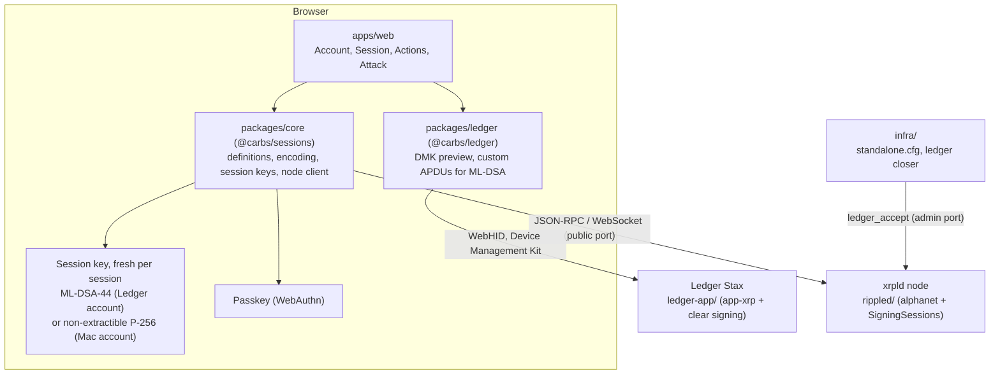
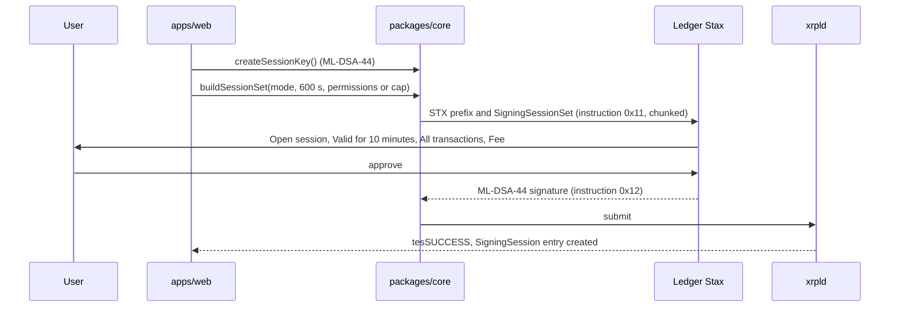

# Architecture

This is the map of the repository. The reasons for each choice are in [`docs/adr/`](adr/); the full specification is [`FIANSO-SPEC.md`](../FIANSO-SPEC.md) (the section numbers below refer to it).

## What the system does

An account opens a **signing session**: a short-lived key (at most 600 seconds) whose limits the **ledger itself** enforces. A session key can sign without a prompt, inside one of three exclusive modes, and can never change who controls the account.

| Mode  | The session key may                                            | Bound                                              |
| ----- | -------------------------------------------------------------- | -------------------------------------------------- |
| **A** | sign every delegable transaction type except an exclusion list | time, fee ceiling                                  |
| **P** | sign the listed XLS-75 permissions                             | time, list, fee ceiling                            |
| **C** | send direct XRP `Payment` only                                 | time, a total XRP cap (fees included), fee ceiling |

A session is opened with **one ordinary signature** from a key that already has full authority: a passkey, or a Ledger that shows the rules on its screen (clear signing). It is not a multisig.

Two account profiles share this engine (decisions D13 and D14, [ADR 0011](adr/0011-two-account-profiles.md)):

| Profile            | Full authority                                                                   | Opens a session with                             | Session key                                           |
| ------------------ | -------------------------------------------------------------------------------- | ------------------------------------------------ | ----------------------------------------------------- |
| **Ledger account** | the device's ML-DSA-44 key as `RegularKey`; master key disabled; never a passkey | an ML-DSA-44 signature on the Stax, clear-signed | ML-DSA-44, generated in the client, fresh per session |
| **Mac account**    | the master key and a passkey                                                     | the passkey (WebAuthn)                           | P-256 WebCrypto, non-extractible, fresh per session   |

## Components

| Directory         | Responsibility                                                                                                                                                  | Language                 | Depends on                                                  |
| ----------------- | --------------------------------------------------------------------------------------------------------------------------------------------------------------- | ------------------------ | ----------------------------------------------------------- |
| `rippled/`        | The amendment `SigningSessions`: ledger entry, two transactions, authorization hook, accounting, invariant, tests                                               | C++                      | upstream `XRPLF/rippled:alphanet` (imported)                |
| `ledger-app/`     | Clear signing of `SigningSessionSet` and `SigningSessionDelete` on the Stax; ML-DSA-44 signing of XRPL transactions (post-quantum root); stretch: P-256 signing | C                        | upstream `LedgerHQ/app-xrp` (imported), `ledger-secure-sdk` |
| `packages/core`   | Everything a client needs that is not UI: sessions, signing, the quantum exposure check and migration; no DOM state, no framework                               | TypeScript               | `xrpl`, `ripple-binary-codec`, `@noble/*`                   |
| `packages/ledger` | Optional library over the Device Management Kit (preview, custom commands)                                                                                      | TypeScript               | `@ledgerhq/device-management-kit`, `device-signer-kit-xrp`  |
| `apps/web`        | The demo screens                                                                                                                                                | TypeScript, Vue 3 / Nuxt | `packages/core`, `packages/ledger`                          |
| `infra/`          | Run the daemon and the demo locally                                                                                                                             | config, TypeScript       | `rippled/`                                                  |
| `docs/`           | Architecture, decisions, DEVLOG, Ledger feedback                                                                                                                | Markdown                 |                                                             |

**Dependency rules.** `apps/web` may import `packages/*`; `packages/core` imports no other workspace package and never touches the DOM; `packages/ledger` imports only `packages/core` types; nothing imports from `rippled/` or `ledger-app/` (they talk through the wire formats below). Protocol codes are never copied into TypeScript: they come from `server_definitions` at run time.

## Interfaces

| Between            | Format                                                                                                                            | Notes                                                                                                                                                                                                                                                                                                               |
| ------------------ | --------------------------------------------------------------------------------------------------------------------------------- | ------------------------------------------------------------------------------------------------------------------------------------------------------------------------------------------------------------------------------------------------------------------------------------------------------------------- |
| client ↔ node      | JSON-RPC and WebSocket (`submit`, `account_info`, `ledger_entry` type `signing_session`, `account_objects`, `server_definitions`) | public non-admin port only; never the node's `sign` RPC with a P-256 key                                                                                                                                                                                                                                            |
| client ↔ Ledger    | APDU through the Device Management Kit: `CLA 0xE0`, `INS 0x02` public key, `0x04` sign, `0x06` configuration                      | classical keys: the app prepends the signing prefix itself, so the client sends the serialized transaction without `STX\0`. ML-DSA-44: `INS 0x10` public key, `0x11` sign, `0x12` signature, in 250-byte chunks, and the client sends `STX\0` with the fields (at most 2 048 bytes). P-256 on the device is stretch |
| client ↔ passkey   | WebAuthn assertion whose challenge is the signed data; result in `PasskeySignature`                                               | normalize the signature to low-S, strict DER                                                                                                                                                                                                                                                                        |
| session key ↔ node | ML-DSA-44 (Ledger account) or ECDSA P-256 with low-S, strict DER (Mac account), over `STX\0 ‖ signed fields`                      | `LastLedgerSequence` on every session transaction, fresh key per session                                                                                                                                                                                                                                            |

## Flows

**Open a session from the Ledger (Ledger account)**

**Use and close**

1. Every action is signed by the session key with no prompt. The node answers with a normal result or a `tefSESSION_*` code: `TX_NOT_ALLOWED`, `EXPIRED`, `LIMIT`. A refused transaction is never included and costs nothing.
2. `SigningSessionDelete` is signed by the session key itself (exempt from the cap and from expiry, not from the fee ceiling), by a full-authority key, or by anyone once the session has expired.

## Where the protocol hooks in (`rippled/`, verified at `68bd02b647`)

| Concern                                                                                   | Location                                                                         |
| ----------------------------------------------------------------------------------------- | -------------------------------------------------------------------------------- |
| Authorization (replaces `T::checkSign` for session-signed transactions, returns `NotTEC`) | `src/libxrpl/tx/applySteps.cpp` `invokePreclaim`, `include/xrpl/tx/Transactor.h` |
| Accounting in mode C (exactly two call sites)                                             | `src/libxrpl/tx/Transactor.cpp` `operator()`                                     |
| Invariant `ValidSigningSession`                                                           | `include/xrpl/tx/invariants/InvariantCheck.h`                                    |
| Definitions: amendment, fields, entry, transactions, keylet                               | `include/xrpl/protocol/detail/*.macro`, `Indexes.h/.cpp`                         |
| Transactors                                                                               | `src/libxrpl/tx/transactors/`                                                    |
| `AccountDelete`, sponsorship tables, RPC                                                  | `AccountDelete.cpp`, `SponsorHelpers.cpp`, `LedgerEntry.cpp`                     |

Section 6.10 of the specification has the full table and the registration checklist.

## Build and test

| Need            | Command                                                                                                                                                                                                                                  |
| --------------- | ---------------------------------------------------------------------------------------------------------------------------------------------------------------------------------------------------------------------------------------- |
| TypeScript      | `pnpm install`, `pnpm format:check`, `pnpm typecheck`, `pnpm test`                                                                                                                                                                       |
| Daemon          | build `rippled/` out of tree (see `rippled/BUILD.md`, Conan cache under `~/.conan2`)                                                                                                                                                     |
| Protocol tests  | `./xrpld --unittest=SigningSessions`, then the upstream suites `Delegate`, `PasskeyListSet`, `AccountDelete`, `PassKey` (green before and after, none removed)                                                                           |
| Generated code  | `cmake -S cmake/codegen -B build/codegen && cmake --build build/codegen --target setup_code_gen && cmake --build build/codegen --target code_gen` (our types only)                                                                       |
| Standalone node | `./xrpld -a --start --conf infra/standalone.cfg` and the ledger closer                                                                                                                                                                   |
| Ledger app      | in the `ledger-app-builder` image: `make BOLOS_SDK=$STAX_SDK`; load from the Mac with `ledgerctl`, `ledgerblue` or Ledger Dev Tools (route to decide, task L0); `make -C ledger-app/unit-tests`; `pytest tests/standalone --device stax` |

## Test strategy

| Level         | What                                                                                                                                                           | Where                                       |
| ------------- | -------------------------------------------------------------------------------------------------------------------------------------------------------------- | ------------------------------------------- |
| Protocol      | jtx suite `SigningSessions` with 24 cases and invariant tests that mutate the view; upstream suites stay green                                                 | `rippled/src/test/`                         |
| Ledger parser | cmocka vectors (one per mode, 10 permissions, unknown permission, unknown flag, truncated, duplicate), fuzzing, Ragger snapshots for every device the CI lists | `ledger-app/unit-tests`, `ledger-app/tests` |
| Library       | unit tests for encoding, low-S and DER, session builders, constants                                                                                            | `packages/core`                             |
| End to end    | a real standalone node, a real session, the refusal codes shown by the Attack screen; the Ledger path on the **real device**                                   | `apps/web`, `infra/`                        |

Anything shown on a device is shown on the Stax; anything simulated is said to be simulated.

The quantum exposure check (`packages/core/src/quantum`) is tested with recorded node responses for a known-exposed and a known-safe account, plus the edge cases of FIANSO-SPEC.md section 8.7.

## Decisions

<<<<<<< HEAD
See [`docs/adr/`](adr/): single repository with unmodified imports (0001), the front from the `create-xrp` template (0007), the session predicate replaces `checkSign` (0002), Device Management Kit only (0003), non-extractible P-256 session keys (0004, now for Mac accounts), opening is one ordinary signature (0005), relative duration in the transaction and absolute expiry in the entry (0006), a post-quantum root on the device with P-256 or ML-DSA session keys (0008, superseded in part by 0011), the licence (0009), a proposal for how sessions use tickets, which serve multisig coordination (0010, not adopted), and two account profiles with ML-DSA-44 session keys on Ledger accounts (0011).
=======
See [`docs/adr/`](adr/): single repository with unmodified imports (0001), the front from the `create-xrp` template (0007), the session predicate replaces `checkSign` (0002), Device Management Kit only (0003), non-extractible P-256 session keys (0004, now for Mac accounts), opening is one ordinary signature (0005), relative duration in the transaction and absolute expiry in the entry (0006), a post-quantum root on the device with P-256 or ML-DSA session keys (0008, superseded in part by 0011), the licence (0009), and two account profiles with ML-DSA-44 session keys on Ledger accounts (0011).
>>>>>>> origin/develop
